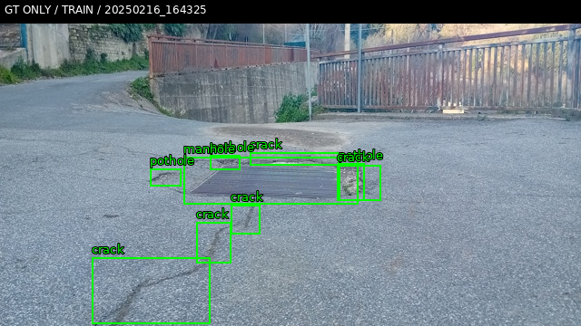
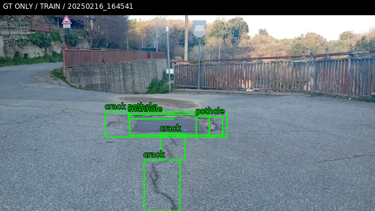
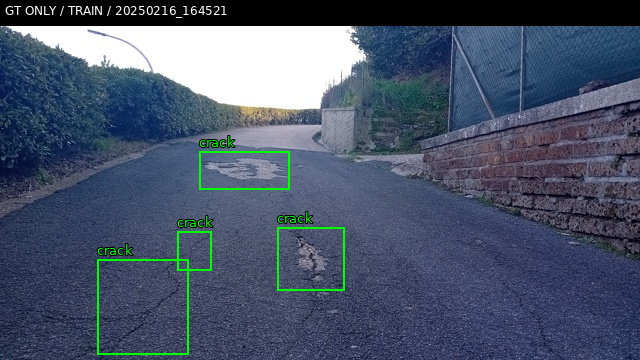
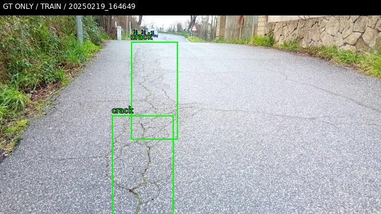
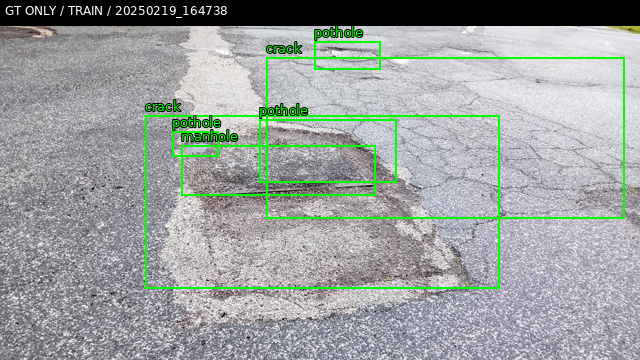
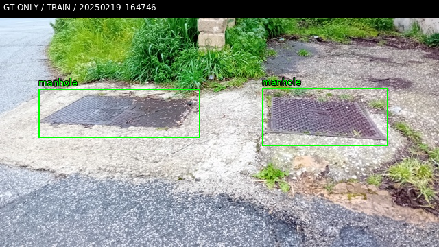

Họ tên: Đinh Quang Lâm
MSSV: 202602875
`dataset_version`: d10-21e4070301

# Day 10 — Qwen3-VL grounding hư hại mặt đường

**Trạng thái: code và kiểm tra CPU đã làm; chưa hoàn thành thí nghiệm GPU E0–E4.** Máy chạy hiện tại không có CUDA/NVIDIA driver dùng được. Colab chưa đăng nhập nên chưa có T4. Không có file điểm E0–E4, thời gian huấn luyện hoặc VRAM thực đo; không thay chúng bằng dữ liệu giả. Các số ở dưới là đo dữ liệu, đếm cấu trúc model thật trên `meta`, và kiểm tra processor/đơn vị. `report/diagnostics/` không phải `report/evidence/`.

## Bảng tổng hợp

<!-- RESULTS_START -->
| Mã | Setup | Tham số có thể huấn luyện (đếm cấu trúc) | VRAM | Phút | F1 / CI95 / FP/ảnh / F1 từng lớp |
|---|---|---:|---|---|---|
| E0 | Zero-shot | 0 | Chưa đo | Chưa chạy | Chưa có kết quả |
| E1 | LoRA LLM r=16 | 33.030.144 | Chưa đo | Chưa chạy | Chưa có kết quả |
| E2 | E1 + projector | 142.135.296 | Chưa đo | Chưa chạy | Chưa có kết quả |
| E3 | E2 + LoRA ViT | 148.426.752 | Chưa đo | Chưa chạy | Chưa có kết quả |
| E4 | Rank 4 và 64; base chọn bằng VAL sau E1–E3 | Phụ thuộc base | Chưa đo | Chưa chạy | Chưa có kết quả |
<!-- RESULTS_END -->

Nguồn đếm: `report/diagnostics/architecture.json`; đây không phải meta của một lần train. Sau khi chạy thật, `python -m student_vlm report` thay bảng bằng `report/evidence/*.json` do trọng tài gốc sinh ra. Cần đọc các output và ảnh lỗi để hoàn tất phân tích thực nghiệm trước khi nộp.

## 10 câu hỏi

### Câu 1 — Kiến trúc và khối được cập nhật

Đã khởi tạo **đúng Qwen3VLForConditionalGeneration / Transformers 5.19.0** với config công khai của Qwen3-VL-4B-Instruct trên `torch.device('meta')`, không nạp trọng số. Tổng 4.437.815.808 tham số, khớp metadata safetensors của model công khai. `architecture.json` ghi:

| Khối | Tham số |
|---|---:|
| LLM + embedding (tied lm_head được đếm một lần) | 4.022.468.096 |
| ViT, chưa gồm projector | 306.242.560 |
| Projector chính và ba DeepStack merger | 109.105.152 |
| Toàn visual, gồm projector | 415.347.712 |

Luồng dữ liệu: ảnh → patch/ViT → merger + DeepStack → token/features vào LLM → JSON grounding. E1 chỉ cập nhật LoRA LLM, 252 module; E2 giữ LoRA LLM và cập nhật đầy đủ các merger; E3 thêm 96 module LoRA ViT, tổng 348. Đếm trainable E2−E1 = 109.105.152; E3−E2 = 6.291.456. Các target được kiểm tra trên cây module thật, không chỉ khớp suffix `q_proj` vì có thể chọn nhầm khối.

### Câu 2 — E0: JSON hợp lệ và lỗi

Chưa chạy E0 nên **chưa biết parse_valid_rate, hai lỗi phổ biến nhất hay output thô thực tế**. `inference.py` giữ nguyên `raw`, kể cả fence/chữ thừa/JSON bị cắt; `scripts/score.py` là trọng tài. Sau GPU run cần kiểm tra output không parse được, box/lớp sai và scale sai trên ảnh. Không lấy JSON đáp án huấn luyện để giả làm output E0.

<!-- E0_RESULT -->

### Câu 3 — Thang 0–1000

Nhãn YOLO `(xc,yc,w,h)` chuyển sang `(xc−w/2,yc−h/2,xc+w/2,yc+h/2)×1000`, làm tròn và kẹp. Khi vẽ, x nhân width/1000, y nhân height/1000. Thang tương đối không phụ thuộc độ phân giải ảnh; chia x/y độc lập cũng quan trọng khi ảnh không vuông.

**Kiểm chứng hình học tự tạo, không phải kết quả model:** `coordinate_unit_check.json` có một GT `(0,5;0,5;0,2;0,4)` trên 640×360, output `[400,300,600,700]`. Trọng tài gốc chấm đúng norm1000 cho F1=1; diễn giải output đó như pixel cho F1=0. Box đúng ở pixel `[256,108,384,252]`; cách đọc sai làm vị trí và kích thước lệch theo hai hệ số khác nhau (1000/640 và 1000/360). **F1 trên output Qwen thật khi dùng sai scale vẫn chưa đo.** E4 đã chọn rank, không thay scale cùng lúc.

### Câu 4 — Mask loss

`encoding.json` dùng **processor thật và hai ảnh TRAIN thật**: 220 token ảnh mỗi ví dụ; batch text/labels/mm types `[2,601]`, pixel_values `[1760,1536]`, image_grid_thw `[2,3]`. Đã kiểm tra token prompt là tiền tố chính xác của chuỗi user+assistant; labels trên tiền tố là −100. Decode các token còn được tính loss ra JSON đáp án và `<|im_end|>` (kèm newline), không có prompt hay token ảnh.

Prompt mô tả nhiệm vụ và ảnh là điều kiện, không phải đáp án cần model dự đoán. Tính loss trên chúng làm mục tiêu bị phần prefix dài chi phối, thưởng việc học lại template thay vì box. Padding labels cũng phải −100; attention padding là 0. `collate_examples` nối tensor ảnh theo chiều 0, không pad như text; giữ `mm_token_type_ids` cho M-RoPE. Có test backward trên Qwen thật với kích thước nhỏ để xác nhận gradient qua LoRA LLM, LoRA ViT và projector; **không phải một lần finetune model 4B**.

### Câu 5 — Lượng tử hóa và projector float32

`load_base` dùng NF4 4-bit + double quantization, compute fp16, skip `visual` và `lm_head`. Ma trận 4-bit là tham số đóng gói/lượng tử kèm scale chứ không phải ma trận float có thể cập nhật đầy đủ bằng AdamW. Projector E2/E3 cần thay trọng số thật, nên visual phải còn unquantized. Không được chỉ bật requires_grad trên Params4bit để coi đó là full finetune.

Projector và LoRA được giữ fp32 khi train: gradient và trạng thái tối ưu ổn định hơn, GradScaler có thể unscale các gradient này; autocast vẫn dùng fp16 cho phép tính phù hợp. Các base weight còn lại đóng băng. AdamW, warmup 5%, cosine, clip norm 1,0 và kiểm tra loss/gradient hữu hạn đã có trong vòng train. Adapter PEFT không lưu projector full: code lưu riêng `projector.pt`, kiểm tra đủ key/shape khi nạp, và có test round-trip. Chưa đo mức ổn định/VRAM trên GPU thật.

### Câu 6 — Split theo phiên quay

Đã chạy **scripts/prepare_data.py gốc** trên dataset Kaggle thật; version `d10-21e4070301`. `dataset.json` ghi session_overlap=false, train/val/test có 13/2/3 phiên, không có phiên trùng giữa split.

| Split | Ảnh | Pothole | Crack | Manhole |
|---|---:|---:|---:|---:|
| Train | 1422 | 1074 | 1750 | 691 |
| Val | 276 | 66 | 470 | 103 |
| Test | 311 | 121 | 299 | 163 |

Frame liền nhau từ một video gần như giống nhau. Chia ngẫu nhiên có thể đưa cảnh gần trùng vào train/test, khiến F1 đo khả năng nhớ cảnh thay vì tổng quát hóa sang phiên khác. Val chỉ có 66 pothole, nên dùng micro F1 đơn độc có thể che hiệu quả của lớp này. Sáu ảnh dưới đây là **GT của TRAIN để kiểm tra nhãn/scale, chưa phải ảnh dự đoán**.

### Câu 7 — E1/E2/E3 có đáng không?

Chưa có F1, CI95, VRAM hoặc phút train thực đo để kết luận setup nào đáng chi phí. Đếm cấu trúc cho thấy E2 tăng trainable khoảng 109M còn E3 thêm khoảng 6,29M, nhưng chi phí E3 còn có activation/gradient qua ViT; số trainable không thay thế đo bộ nhớ hay thời gian. Pipeline giữ cùng seed, learning rate, batch, accumulation và 300 optimizer steps; đo thời gian/peak VRAM thật vào run.json rồi chuyển vào meta của trọng tài. TEST không dùng để chọn E4 base: `choose_ablation_base` chỉ nhận split=val và loại test.

### Câu 8 — CI trên 311 ảnh

Chưa có khoảng CI của model thực tế. `score.py` bootstrap F1 theo ảnh; không nên diễn giải vài điểm chênh F1 là tiến bộ chắc chắn. Cần nhìn CI, số mẫu/lớp và so sánh ghép cặp cùng ảnh; CI chồng nhau không phải phép kiểm định chính thức về hiệu số. Chỉ có **3 phiên quay TEST**, frame trong phiên vẫn tương quan, nên bootstrap theo ảnh còn có thể đánh giá thấp bất định sang phiên mới. Cần thêm phiên độc lập để kiểm chứng tổng quát hóa.

<!-- CI_RESULT -->

### Câu 9 — Phân tích lỗi theo lớp

Chưa biết lớp có F1 thấp nhất vì chưa chạy suy luận; không suy ra bảng xếp hạng từ số lượng nhãn. Các giả thuyết cần kiểm tra: crack mảnh làm IoU nhạy với lệch vài pixel; pothole lẫn vùng tối/bóng; manhole lẫn họa tiết mặt đường. Những giả thuyết này chưa phải kết quả thực nghiệm. Sau GPU run, `prediction_figures` chọn 3 ảnh E1 có F1 thấp và 3 ảnh cao, vẽ GT xanh/pred đỏ và giữ raw/caption để đọc lỗi. Sáu ảnh GT ở câu 6 **không thay thế** sáu ảnh dự đoán đúng/sai mà RUBRIC yêu cầu.

### Câu 10 — E4 rank ablation

Chọn rank **4 và 64**, alpha=2r theo GUIDE, base là setup tốt nhất theo **VAL** giữa E1–E3 (hòa thì ít trainable hơn). Chỉ r và alpha dẫn xuất thay đổi; prompt, coordinate scale, data, batch/accumulation, LR, seed, steps và các khối được mở giữ nguyên. Có test so hai config sau bỏ name/r/alpha phải bằng base, và test không nhận TEST để chọn base. Chưa chạy E4 nên chưa có kết quả hay kết luận về độ tin cậy. Phải giữ cả hai evidence `e4_rank_4.json` và `e4_rank_64.json`, không chọn rank theo TEST để train lại.

## Nhìn lại

Đã hoàn thành code, dữ liệu QA, encoding và kiểm thử CPU. **Việc còn lại để nộp đạt yêu cầu:** đăng nhập Colab, cấp T4, chạy E0–E3 và hai rank E4, lưu evidence/log/ảnh dự đoán, cập nhật các phân tích thực nghiệm còn thiếu, rồi chạy check_submission.py không còn FAIL. E5 mới có reward đúng và test, chưa chạy GRPO và không tuyên bố bonus chạy RL.

Một test gốc (`test_report_template_has_student_markers_and_ten_questions`) đòi REPORT.md vẫn chứa chuỗi placeholder, trong khi check_submission.py cấm chính chuỗi đó. Đã giữ nguyên scripts/tests; bản báo cáo đã trả lời sẽ không qua test kiểm tra template này. Bộ test chức năng CPU được chạy riêng và ghi rõ test template được deselect, không coi đó là test model đã đạt.

Tài liệu triển khai: [Qwen3-VL / Transformers 5.19.0](https://huggingface.co/docs/transformers/v5.19.0/model_doc/qwen3_vl), [PEFT quantization](https://huggingface.co/docs/peft/main/developer_guides/quantization). Dữ liệu: [Road damage / Kaggle](https://www.kaggle.com/datasets/lorenzoarcioni/road-damage-dataset-potholes-cracks-and-manholes).
